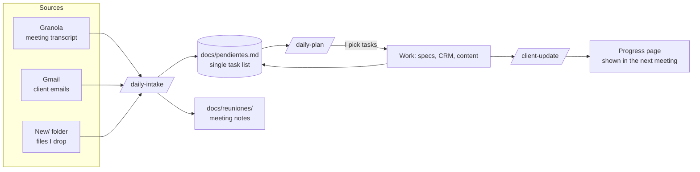

# claude-skills-ops-routine

Claude Code skills and working method I built to run the day-to-day operations and CRM automation of a small Medicare insurance agency: meetings, email, a task list, GoHighLevel (GHL) pipelines and workflows, compliance-reviewed content and a client-facing progress page.

> The client and every name, ID and figure in the examples are **fictional** (Avery Benefits Group / Jordan Avery). The real repository holds client data and stays private; this one keeps only the method.

## The problem

One operator supports one broker who works by short daily meetings and quick emails. Requests arrive scattered (a meeting transcript, an email, a file dropped in a folder), the CRM has ~140 workflows where any change hits real clients, and every client-facing word has to pass a compliance review. Things get lost, and doing everything by hand doesn't scale during the Medicare Annual Enrollment Period.

## How it works



| Skill | What it does |
|---|---|
| [`daily-intake`](skills/daily-intake/SKILL.md) | Reads the latest meeting (summary **and** transcript), recent client emails and the `New/` inbox; files every document where it belongs and turns every request into a task. Implements nothing. |
| [`daily-plan`](skills/daily-plan/SKILL.md) | Classifies open tasks (urgent / client waiting / doable now / blocked / other session) against fixed deadlines, proposes an order and asks one multi-select question. Only then implements, marking and committing each task. |
| [`client-update`](skills/client-update/SKILL.md) | Builds a dated "what's new" page with only the progress since the last meeting, in first person and plain English, following compliance wording, and lists the documents to have open. |
| [`ghl-connect`](skills/ghl-connect/SKILL.md) | Connects Claude to GoHighLevel via the LeadConnector connector with hard safety rules: 2FA by email only, the user types passwords and codes, OAuth needs an explicit yes, reads before writes, `dryRun` + `idempotencyKey`. |

Larger CRM projects follow a spec-driven flow ([GitHub Spec Kit](https://github.com/github/spec-kit), whose `speckit-*` skills I used as-is): `spec.md → plan.md → tasks.md → execution-log.md → handoff.md`. See the [example spec](examples/specs/001-scheduling-link-appointments/).

## What was built with it

Detailed in [docs/AUTOMATIZACIONES.md](docs/AUTOMATIZACIONES.md) (Spanish):

- **Channel-aware confirmations**: trigger links per channel, a custom field and branching so each client gets answers by the channel they used.
- **Appointment requests via an external scheduling link**: pipeline stages fire prefilled links, bookings and cancellations move the opportunity automatically, reminders and a call task if nobody books.
- **A "Won / Lost / Abandoned ➡️ Stop" rule per pipeline** that removes closed clients only from that pipeline's workflows.
- **A webinar campaign** with its own 7-stage pipeline, 5 workflows, an RSVP form and date-driven waits read from custom values.
- **A no-show webhook** to a Google Apps Script that books a follow-up in the broker's calendar.
- **A content pipeline** where one Markdown file per topic generates the newsletter HTML and the PDF/DOCX compliance package (Python standard library).
- A 12-page website rebuilt in the CRM's builder with local SEO and JSON-LD, approved by compliance and launched.

## Repository layout

```text
skills/                 # the four skills I wrote (copy into .claude/skills/)
examples/
  CLAUDE.md             # sample project memory: rules, IDs, lessons
  pendientes.md         # sample single task list
  reuniones/            # sample meeting note
  specs/001-…/          # sample spec → plan → tasks → handoff
docs/
  AUTOMATIZACIONES.md   # CRM automations built (anonymized)
  FORMACION_PROFESIONAL.md
```

## Using the skills

1. Copy `skills/*` into your project's `.claude/skills/`.
2. Adapt `examples/CLAUDE.md` as your project's `CLAUDE.md` (operator name, client, rules).
3. Connect the tools the skills expect: Granola, Gmail and the LeadConnector (GHL) connector in the Claude app.
4. Run `/daily-intake`, then `/daily-plan`, then `/client-update`.

## Tech

Claude Code (skills, project memory, MCP connectors) · GoHighLevel / LeadConnector API · GitHub Spec Kit · Granola · Gmail · Google Apps Script · Python (standard library) · HTML/CSS · Git.

## Author

Sofia Rodriguez ([@Sofiro11](https://github.com/Sofiro11)): design of the routine, the skills and the rules, and every automation described here.
