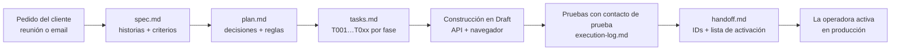

# Automatizaciones de CRM construidas (caso real, anonimizado)

Este documento describe el trabajo técnico que hay detrás de las skills: los pipelines, workflows e integraciones que diseñé, construí, probé y entregué en la sub-cuenta de GoHighLevel (white-label) de una agencia de seguros de Medicare en California. Llamo a la agencia **Avery Benefits Group** y al broker **Jordan Avery** (nombres ficticios). Quité IDs, URLs, nombres de aseguradoras y datos de clientes.

Periodo: septiembre–octubre de 2026, en plena preparación de la temporada de inscripción anual de Medicare (AEP, 15/10–7/12).

## Método común a todos los proyectos

- **Spec-driven development** con [GitHub Spec Kit](https://github.com/github/spec-kit) adaptado a no-code: cada proyecto vive en `specs/NNN-<tema>/` (ejemplo en [examples/specs/](../examples/specs/001-scheduling-link-appointments/)).
- **Lectura primero:** antes de construir, foto de versiones de cada workflow por API (línea base). Al terminar, se comprueba que los publicados no cambiaron de versión.
- **Nunca editar lo que está en vivo:** si un workflow publicado necesita cambios, se trabaja sobre una copia en Draft que sustituye al original al activarse.
- **Escrituras por API** con `dryRun: true` primero e `idempotencyKey`.
- **Pruebas** con un contacto de prueba (tag `test`) y filtros `Has tag = test` en los triggers de las copias, para que nada llegue a clientes reales.
- **Lo que la API no expone** (pasos, triggers, logs de workflows, Bulk Actions) se hace con el navegador sobre el builder visual, con un runbook de trucos documentado (foco, zoom, menús por teclado).

## 1. Confirmación por el mismo canal del link (campaña AEP)

**Problema:** la campaña anual mandaba SMS y emails con el link a una encuesta de revisión de plan; al completarla, el cliente recibía la confirmación por los dos canales, sin importar por cuál había llegado.

**Solución:**
- Dos **trigger links** (uno para SMS y otro para email) que redirigen a la misma encuesta externa.
- Un **campo de contacto** `Canal` (SMS / Email).
- Workflow "Survey link clicked ➡️ Save channel": dos triggers, guarda el canal y un tag; si el cliente hizo clic en los dos, **gana SMS** (regla con tags para resolver el conflicto).
- **Copia** del workflow principal de la campaña (6 SMS + 6 emails, esperas por **fecha fija**), con cada mensaje apuntando a su trigger link y un primer paso que saca al contacto del original.
- **Copia** del workflow de confirmación con un If/Else de tres ramas: Solo SMS, Solo Email y None (fallback a los dos), que contempla contactos sin teléfono o sin email.

**Dificultad clave:** ~830 clientes estaban esperando en un paso de fecha fija del workflow original. Al migrar a la copia, las fechas ya pasadas no esperan, así que hubo que planear en qué paso entra cada cliente.

## 2. Citas por link de agenda externa

**Problema:** el broker mandaba a mano el link de su agenda (Calendly) cliente por cliente y movía las oportunidades a mano.

**Solución:**
- Dos columnas nuevas en el pipeline ("Request Appointment 15 min" / "60 min").
- Dos workflows de envío disparados por **cambio de etapa**: sacan al cliente de la secuencia anterior, eligen el canal (reutilizando el campo del proyecto 1) y mandan el link **prellenado** con nombre y email.
- Recordatorio a los 2 días y **tarea para el broker** a los 4 si no reserva.
- Copias de los workflows de confirmación y cancelación, escuchando los **calendarios sincronizados** de la agenda externa (un trigger por calendario, porque el filtro acepta un solo valor). Al reservar: oportunidad → "Appointment Set"; al cancelar: → "Cancelation".

**Hallazgos documentados:** `{{contact.name}}` con espacio rompe el link en SMS (se usa `first_name%20last_name`); una reprogramación llega como actualización de la misma cita; las reservas también llegaban duplicadas por Google Calendar a otro calendario y los workflows nuevos se aislaron de ese calendario.

**Estado:** probado en vivo (reserva, cancelación, reprogramación y las tres ramas de canal) y activado en producción.

## 3. Regla "Won / Lost / Abandoned ➡️ Stop" por pipeline

**Problema:** clientes ya cerrados (ganados o perdidos) seguían recibiendo mensajes de la campaña.

**Solución y regla de diseño:**
- Cada pipeline tiene **su propio** workflow Stop: tres triggers "Opportunity status changed" (Won, Lost, Abandoned; uno por estado, porque el filtro admite un solo valor), todos filtrados a ese pipeline, con re-entry activado.
- Su única acción es "Remove from Workflow" con **solo los workflows de ese pipeline**. Nunca "Remove from All Workflows", que sacaría al cliente del newsletter, de las reseñas, etc.
- La regla quedó como estándar: cada spec que crea pipelines o workflows incluye una tarea para agregarlos a su Stop.
- Limpieza retroactiva: identifiqué a los clientes que ya estaban en Won/Lost y los saqué de la campaña.

## 4. Campaña de webinar con pipeline propio

**Alcance:** invitar a ~210 clientes de una aseguradora a un webinar sobre cambios en su plan, gestionar la inscripción, los recordatorios y el seguimiento.

- **Pipeline de 7 etapas:** Invited → Invited – 2nd Invite → Registered → Attended / No Show → Follow Up / Not Interested.
- **5 workflows:**

| # | Entrada | Qué hace |
|---|---|---|
| W1 Invitation | Sin trigger: Bulk Action desde una Smart List | Tag, oportunidad, invitación SMS + email; segunda invitación si no se inscribió |
| W2 Registration | Formulario RSVP | Saca de W1, distingue invitados de "amigos", confirma y manda recordatorios 3 días / 1 día / 1 hora antes, avisa al broker |
| W3 Date change | Tag | Aviso de cambio de fecha |
| W4 Attended | Tag | Gracias + grabación + link de agenda |
| W5 No Show | Tag | "Sorry we missed you" + grabación |

- **Esperas dinámicas:** todos los datos del evento (fecha en texto, fecha en formato máquina, link de Zoom, dial-in, grabación) están en **custom values**. Las esperas leen la fecha de un custom value, así que cambiar la fecha del evento no exige tocar ningún workflow.
- **Cruce de datos:** crucé la lista en Excel del broker con los contactos del CRM, taggeé por aseguradora y plan, generé un reporte de coincidencias y una lista de duplicados para fusionar, con una regla de qué registro conservar.
- **Compliance:** documento con todas las comunicaciones (PDF + Word) para la revisión de la agencia antes de publicar.
- Procedimiento post-evento: exportar asistencia de Zoom, cruzar por email y taggear asistentes / no-shows en bloque.

## 5. No-show ➡️ evento en el Google Calendar del broker

- Webhook desde un workflow del CRM hacia un **Google Apps Script** (`doPost`) que crea un evento de 15 min el siguiente día hábil a las 9:00 (hora del Pacífico), con aviso emergente.
- Autenticación por **token compartido** guardado en Script Properties (nunca en el código); validación de JSON y campos obligatorios.

## 6. Pipeline de contenido y paquetes de compliance

- Cada tema nace en un único Markdown con secciones (Blog / Facebook / Google Business Profile / Newsletter).
- **Scripts en Python (solo librería estándar)** generan el HTML del newsletter y el paquete de compliance; Edge headless lo exporta a PDF y Word (COM) a DOCX.
- Reglas de redacción del sector codificadas en la memoria del proyecto (sin "free", nada de pedir datos de salud por email/SMS, avisos obligatorios, mayúsculas, sin nombres de aseguradoras).
- Spec de calendario de contenido con recordatorios en el Google Calendar del broker (grabar videos una semana antes, enviar paquetes a compliance 14 días antes).

## 7. Sitio web

- 12 páginas reconstruidas como **Custom HTML** dentro del builder del CRM (diseño responsive, modo oscuro, SEO local con meta tags y **JSON-LD**), integrando formularios, encuestas, calendario y widget de reseñas del CRM.
- Escaneo de ~360 enlaces y de las páginas antiguas para evitar choques de rutas.
- Correcciones de **compliance** (ticket de la agencia) aplicadas y verificadas comparando la vista previa publicada con los archivos locales. Sitio aprobado y lanzado en el dominio real, con plan de rollback.

## 8. Inventario y operación

- Inventario por API de ~139 workflows (nombre y estado) y de formularios, encuestas y calendarios usados por el sitio.
- Memoria del proyecto (`CLAUDE.md`) con IDs, reglas, decisiones y lecciones de herramientas, para que cualquier sesión retome el trabajo.
- Rutina diaria con tres skills ([README](../README.md)).
